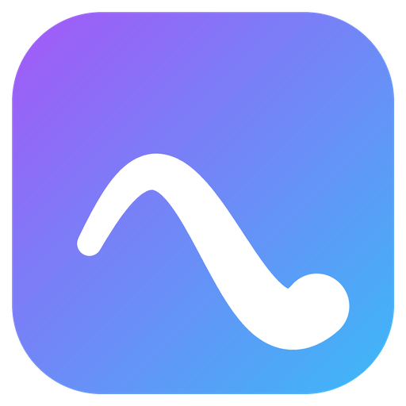

<div align="center">



# SketchGL

**A simple, fast sketchpad for desktop.**

Pick a brush, pick a color, and draw. No accounts, no clutter, no waiting.

Built on [RenGL](https://github.com/piitex/RenGL) and Java 25.

</div>

---

## Why SketchGL

- **Five tools that feel like the real thing.** Brush, pencil, marker, spray and eraser, each with its own size, opacity, hardness and smoothing.
- **Smooth strokes.** Opacity is applied to the whole stroke, so crossing your own line never leaves a darker patch.
- **Fill, pick, move.** A flood fill, a color picker, and a hand tool for panning.
- **Zoom in close.** Zoom around the pointer, jump to fit or actual size, and drag the canvas corners to resize it.
- **Undo anything.** Every stroke, fill and resize is a step you can take back.
- **Transparent pictures.** Start with a see-through background and the eraser rubs back to transparent.
- **Big canvases.** Up to 16384 pixels on a side and 100 megapixels in all.
- **Runs anywhere.** Windows, macOS and Linux, with its own Java included in the installers.

## Get it

Download the build for your platform from the [releases page](https://github.com/piitex/SketchGL/releases):

| Platform | Download |
|---|---|
| Windows | `.exe` installer |
| macOS | `.dmg` |
| Linux | `.deb` or `.rpm` |
| Anywhere with Java 25 | `.jar` |

To run the jar:

```bash
java -XstartOnFirstThread --enable-native-access=ALL-UNNAMED -jar sketchgl.jar
```

`-XstartOnFirstThread` is only needed on macOS, so leave it off on Windows and Linux.

## Shortcuts

| | |
|---|---|
| Tools | `B` brush, `P` pencil, `M` marker, `S` spray, `E` eraser, `G` fill, `I` picker, `H` hand |
| Size | `[` and `]` |
| Pick a color | Right-click or Alt+click with any tool |
| Zoom | Mouse wheel, `+` / `-`, Ctrl/Cmd+`0` to fit, Ctrl/Cmd+`1` for actual size |
| Pan | Hold Space and drag |
| Undo / redo | Ctrl/Cmd+Z, Ctrl/Cmd+Shift+Z |
| New / Open / Save | Ctrl/Cmd+N, O, S (Shift+S for Save As) |

## Build it yourself

You need JDK 25. Pictures open and save as PNG.

```bash
./mvnw package
```

To make the installers, point `RENGL_HOME` at a [RenGL](https://github.com/piitex/RenGL) checkout (or clone it next to this folder) and run `package.cmd`. The settings are in `rengl-package.properties`.

## Under the hood

- `canvas/` is the picture and has no UI: pixels, strokes, fill and undo.
- `ui/` is the window: zoom, pan, the toolbox and the side panel.
- `Sketch` wires them together and handles New, Open and Save.
